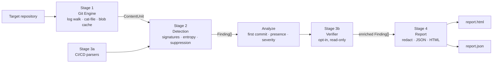

# Git Leak Hunter

**A defensive supply-chain secret-exposure scanner for Git history and CI/CD configuration.**

`git-leak-hunter scan <repo>` walks the **entire reachable Git history** (every commit on every
ref, not just the working tree), finds accidentally committed secrets using regex signatures plus
Shannon entropy, and scans CI/CD configuration (GitHub Actions, GitLab CI, Dockerfiles, committed
credential files). It classifies findings as **Critical / High / Medium / Low**, can optionally run
read-only **verification** of AWS and GitHub credentials, and writes a **self-contained HTML
report** plus JSON. Every secret is **redacted**.

```
DETECT → ANALYZE → VERIFY → REPORT          Repository → ContentUnit → Finding → Report
```

## Why

A developer can delete a secret in a later commit, but it stays recoverable from Git history until
the history is rewritten. _Scanning only the current working tree is not enough._ Every finding
says whether the secret is still **present at HEAD** or is **history-only** (deleted but still
recoverable): the case this tool exists for.

## Features

- **Full-history scanning.**
  - Streams `git log --all` with merges diffed against each parent, so secrets introduced only in
    a conflict resolution are found.
  - Reads content by blob hash; it never checks out a commit.
- **Blob-hash memoization.** Each unique blob is scanned once, however many commits, paths or
  branches carry it: `O(unique blobs)` instead of `O(commits × files)`. Use `--no-cache` to compare.
- **Hybrid detection.**
  - Signatures: AWS key pairs, GitHub, Stripe, Slack, private keys.
  - Generic secret-like assignments are checked with length-normalised Shannon entropy.
- **CI/CD-aware.**
  - Parses workflow and pipeline YAML (GitHub Actions `env:`/`with:`, GitLab `variables:`).
  - Parses Dockerfile `ENV`/`ARG`, including line continuations.
  - Detects committed `.env`, `id_rsa`, `.npmrc`, `credentials.json`, `.pgpass`, `.netrc`, …
  - All of these are scanned across history, not just at HEAD.
- **False-positive suppression.** UUIDs, git SHAs, lockfile hashes, placeholders, documentation
  example keys, `${{ secrets.X }}` / `$VAR` references, repeated characters and data URIs are
  suppressed. Every suppression reason is counted.
- **Table-driven severity**, documented in [docs/RULES.md](docs/RULES.md) and overridable in config.
- **Optional live verification** (`--verify --confirm-authorized`): AWS `sts:GetCallerIdentity` and
  GitHub `GET /user` only, with a hard host allowlist, no redirects, rate-limit aware.
- **Safe reports.**
  - Single-file HTML "case file" report with a strict CSP and no external resources; every value
    is escaped. It includes:
    - an overview with severity charts, the HEAD vs history-only split, and a first-committed
      timeline;
    - a searchable, filterable findings explorer with per-finding remediation steps;
    - scan statistics, light/dark themes, and print styles.
  - JSON is validated against [schema/report.schema.json](schema/report.schema.json).
  - No full secret appears in any output; the test suite enforces this.
- **Optional GitHub dorking** (`dork --owner <you>`). Searches the GitHub code-search API, only
  within an owner the token's account controls, and reports through the same redacted pipeline.
- **Untrusted-input hardening.** No hooks, fsmonitor, pager or `ext::` transports; `-z` parsing;
  ReDoS-tested detectors; size cap; binary skip. Details in
  [docs/ARCHITECTURE.md](docs/ARCHITECTURE.md#hardening-untrusted-input).

## Install

Requirements: **Node.js ≥ 20** and **git ≥ 2.36**. Running the test suite and dev tooling needs
Node ≥ 22.12. Tested on macOS (Apple Silicon) and Linux.

```bash
git clone https://github.com/The-Creative-Developer/git-leak-hunter.git
```

```bash
cd git-leak-hunter && npm ci && npm run build
```

Then run `node dist/cli.js …`, or `npm link` to get a `git-leak-hunter` command on your `PATH`.

## Usage

```
git-leak-hunter scan <path-or-url> [options]
  --out <dir>                 output directory (default ./leak-report)
  --format html,json          output formats (default: both)
  --max-commits <n>           stop after n commits
  --since <date>              only commits after this date
  --branch <name>             walk only this branch (default: all refs)
  --no-ci                     skip CI/CD configuration parsing
  --no-cache                  disable blob memoization (benchmark use)
  --entropy-hex <n>           hex entropy threshold, bits/char (default 3.0)
  --entropy-base64 <n>        base64 entropy threshold, bits/char (default 4.5)
  --min-length <n>            minimum entropy candidate length (default 20)
  --ignore <file>             extra ignore rules (globs, fingerprint:<hex>)
  --config <file>             JSON config: thresholds, severity overrides, ignores
  --fail-on <severity>        exit 1 if any finding is at/above critical|high|medium|low
  --verify --confirm-authorized   opt-in, read-only live verification
  --quiet / --verbose
```

**Exit codes:** `0` scan completed (no finding at or above `--fail-on`), `1` findings at or above
`--fail-on`, `2` usage or runtime error.

**Remote URLs** (`https://…`, `ssh://…`, `git@host:path`) are bare-cloned into a temporary
directory, with hooks disabled and no checkout, and removed afterwards. An authorization notice is
printed before cloning, and credentials in the URL never appear in output.

Sample run on the `history-only` fixture (`npm run fixtures -- demo-repos` builds it; this is
real output):

```
$ git-leak-hunter scan history-only
✓ walking commit history  (4 commits, 6 file versions)
✓ regex signature scan  (6 unique blobs, 0 cache hits)
✓ entropy analysis  (1 candidate suppressed)
✓ CI/CD config scan  (0 CI/CD files)
! 3 findings detected  (0 critical, 3 high, 0 medium, 0 low; 3 history-only)
✓ report.html generated  (leak-report/report.html)
✓ report.json generated  (leak-report/report.json)
```

A sample report generated from the `ci-configs` fixture (fabricated secrets only) is in
[examples/report.html](examples/report.html) and [examples/report.json](examples/report.json).

### Optional: GitHub dorking (owners you control only)

```bash
GITHUB_TOKEN=<your token> git-leak-hunter dork --owner <your-login> --confirm-authorized
```

`dork` runs built-in code-search terms (`AKIA`, `ghp_`, `sk_live_`, `filename:.env`,
`filename:id_rsa`, …) through the GitHub code-search API. It fetches matching files by blob SHA
and scans them with the same detection engine, writing the same redacted HTML/JSON report.
Guardrails:

- **Ownership check before any search.** The token's account must be the owner itself, or an
  active **admin** of the org (`--org`, needs `read:org`).
- **Strict query scope.** Every query carries exactly one `user:<owner>`/`org:<owner>`
  qualifier, added by the tool. Queries with any other scope qualifier or `OR` are refused.
- **Network limits.** Only `api.github.com` is contacted (https, no redirects). Requests are
  paced to the 10-per-minute code-search budget and stop at the first rate limit.
- **Default branches only.** GitHub code search indexes default branches only, so use
  `scan <repo-url>` for full history.

`--term <t…>` replaces the built-in terms, `--max-results <n>` caps the files fetched (default
100), and `--org` marks the owner as an organization.

### Configuration and ignores

```json
{
  "entropy": { "hex": 3.0, "base64": 4.5, "minLength": 20 },
  "maxFileBytes": 2097152,
  "severity": { "stripe-test-key": "high" },
  "ignore": ["docs/examples/", "fingerprint:<32-hex>"]
}
```

Ignore rules can come from four places:

- `.leakhunterignore` at the scanned repo's HEAD;
- `--ignore <file>`;
- the config file's `ignore` list;
- an inline `leakhunter:ignore` comment on a line.

The config file is read only from your side, never from the scanned repository.

## Architecture



| Document                                           | Contents                                                                                                                |
| -------------------------------------------------- | ----------------------------------------------------------------------------------------------------------------------- |
| [docs/ARCHITECTURE.md](docs/ARCHITECTURE.md)       | the four stages, data model, git invocations, memoization and complexity, hardening, known limitations                  |
| [docs/RULES.md](docs/RULES.md)                     | every signature, the entropy maths and thresholds (incl. the length gotcha, measured), suppression list, severity table |
| [docs/BENCHMARK.md](docs/BENCHMARK.md)             | accuracy vs Gitleaks / TruffleHog and the memoization benchmark, generated from real runs                               |
| [docs/RESPONSIBLE_USE.md](docs/RESPONSIBLE_USE.md) | rules for using this tool, and how the code enforces them                                                               |
| [docs/DEMO.md](docs/DEMO.md)                       | the exact demo script                                                                                                   |

## Responsible use

Scan only repositories you own or are explicitly authorized to scan. Use fabricated secrets in test
repositories. Live verification is read-only and opt-in. Never exploit discovered credentials, and
report any genuinely live finding privately to the owner. Secrets are redacted by default. See
[docs/RESPONSIBLE_USE.md](docs/RESPONSIBLE_USE.md).

## Development

| Task                                   | Command                     |
| -------------------------------------- | --------------------------- |
| Install (lockfile, no install scripts) | `npm ci`                    |
| Typecheck · lint · format · tests      | `npm run check`             |
| Coverage                               | `npm run coverage`          |
| Build fixture repos + ground truth     | `npm run fixtures -- <dir>` |
| Benchmarks → `docs/BENCHMARK.md`       | `npm run bench`             |
| Entropy calibration table              | `npm run bench:entropy`     |

How the test suite is built:

- Fixture repositories are **built at test time** with real `git` (`test/fixtures/buildRepos.ts`).
  Fabricated secrets are assembled from fragments, so no token-shaped literal ever exists in this
  repository; `test/unit/hygiene.test.ts` enforces this.
- The suite covers:
  - every detector, with positive and negative cases;
  - the reachable-blob invariant;
  - leak checks on HTML, JSON, stdout and stderr;
  - XSS, schema validation and ReDoS budgets;
  - a 2,000-commit synthetic repo;
  - the remote-clone path;
  - mocked verification, including a guard that fails on any non-allowlisted host.

```
src/
  cli.ts  pipeline.ts  analyze.ts  config.ts  types.ts
  git/      Stage 1: exec (safe spawn), repo (open/clone), log (streaming walk), catFile, index (cache + counters)
  detect/   Stage 2: signatures, generic, entropy, suppress, fileKind, ignore, severity, engine
  ci/       Stage 3a: githubActions, gitlabCi, dockerfile, credentialFiles
  verify/   Stage 3b: vault, http (allowlist), sigv4, aws, github, index
  report/   Stage 4: redact, sanitize, json, html
  dork/     optional: queries (scope guard), github (API client), index (pipeline)
schema/report.schema.json   test/   bench/   docs/   examples/
```

## Team

Ethical Hacking course project, **Group 34**:

| Name              | Roll no. |
| ----------------- | -------- |
| Pruthvi Gangapure | 12415034 |
| Prathamesh Yewale | 12413969 |
| Yash Waghmare     | 12410801 |
| Chetan Thakur     | 12413081 |

Guide: **Prof. Jyoti Yadav**
