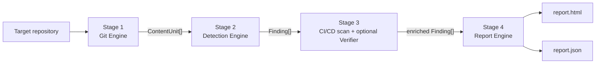

# Architecture

> Status: Phases 1–4 implemented, plus the optional GitHub dorking stretch (`dork`).

Git Leak Hunter scans the **entire reachable history** of a Git repository, not just the working
tree, because a secret deleted in a later commit stays recoverable until history is rewritten.



Pipeline: `DETECT → ANALYZE → VERIFY → REPORT`. Data model:
`Repository → ContentUnit → Finding → Report` (see `src/types.ts`, `schema/report.schema.json`).

## Data model

| Type          | Meaning                                                                                                                                                                                    |
| ------------- | ------------------------------------------------------------------------------------------------------------------------------------------------------------------------------------------ |
| `ContentUnit` | One file version as seen in one commit: `repo, commitHash, author, date, filePath, blobHash, content, origin, lineOffsets`.                                                                |
| `Finding`     | One detected secret at one location. Location-based `fingerprint`, redacted preview, severity, presence (`in-HEAD` / `history-only`), verification status. **No raw-secret field.**        |
| `Report`      | Repository, scan options, measured stats, severity summary and sorted findings. Serialised as `report.json` (validated against the schema) and rendered as a self-contained `report.html`. |

Design decision: the fingerprint hashes `(ruleId, blobHash, filePath, line, column)`. The spec lists
`(ruleId, blobHash, line, offset)`; `filePath` is added because the same blob can live at several
paths (see the `blob-reuse` fixture), and each path is a separate place that needs cleaning up. It
is still never derived from the secret value.

## Stage 1 — Git Engine (`src/git/`)

- Opens a local path, or clones a URL as a bare clone into a temp dir (hooks disabled, no
  checkout, removed afterwards even on failure).
- Walks `git log --all` with raw diff output (`-z`, full blob hashes, merges diffed against each
  parent) so it gets commit metadata plus the changed paths and their blob hashes.
- Reads content by blob hash through one long-lived `git cat-file --batch-command` process
  (`info` first, so oversize blobs are never transferred). It never checks out a commit.
- Counters (measured, never estimated): `commitsWalked`, `fileVersionsSeen`, `uniqueBlobsScanned`,
  `cacheHits`, `bytesScanned`, `durationMs`.

**Git invocations** (`src/git/exec.ts` is the only module that spawns git, always with an argv array):

| Purpose              | Command                                                                                                                                                                                                              |
| -------------------- | -------------------------------------------------------------------------------------------------------------------------------------------------------------------------------------------------------------------- |
| History walk         | `git log --topo-order --reverse -m --root --raw -z --no-abbrev --no-renames --no-ext-diff --no-textconv --format=<nonce marker + %H %P %an %ae %aI %s> [--max-count] [--since] (--all \| --end-of-options <oid>) --` |
| Blob reads           | `git cat-file --batch-command` (`info <oid>`, `contents <oid>`)                                                                                                                                                      |
| HEAD tree (presence) | `git ls-tree -r -z --full-tree --end-of-options <oid>`                                                                                                                                                               |
| Ref resolution       | `git rev-parse --verify --quiet --end-of-options <ref>^{commit}`                                                                                                                                                     |
| Clone                | `git clone --bare --quiet --template= -- <url> <tmp>`                                                                                                                                                                |

Every call is prefixed with `-c core.hooksPath=/dev/null -c core.fsmonitor=false -c core.pager=cat
-c protocol.allow=never -c protocol.https.allow=always -c protocol.ssh.allow=always
-c submodule.recurse=false --no-pager`. `GIT_*` variables that would redirect git (`GIT_DIR`,
`GIT_WORK_TREE`, …) are removed from the environment, and prompts are disabled. Remote URLs must be
`https://`, `ssh://` or scp-like ssh; `ext::`, `file://` and option-like values are rejected before
anything is spawned. Credentials in URLs are stripped from every message and from the report.

**Streaming parser** (`src/git/log.ts`). stdout is split into NUL-terminated tokens as it arrives.
Each commit header starts with a marker carrying a random per-run nonce, so an attacker-controlled
subject or path cannot forge a commit boundary. Raw records (`:<mode> <mode> <old> <new> <status>`
followed by the path token) are yielded one by one, so memory grows with the number of file
versions, not with blob content. Deletions and gitlinks (submodules, mode 160000) are skipped.
Merges are diffed against **each** parent (`-m`), so a secret introduced only while resolving a
conflict is seen (fixture `merge-conflict`).

**Presence.** After the walk, the HEAD tree (or the `--branch` tip) is listed. Each path's blob
result comes from the cache; blobs a limited walk (`--max-commits`/`--since`) never reached are
scanned with `origin: 'head'`. A finding is `in-HEAD` when the same secret is found at the same path
there, otherwise `history-only`.

### Memoization (DAA connection)

A naive scan reads every file of every commit: `O(commits × files)`. Git Leak Hunter scans only the
files a commit changed, and keys detection results by blob hash (plus a ruleset/config hash), so
identical content reached through other commits, paths, branches or reverts is scanned once:
`O(unique blobs)`. Per-commit attribution (first commit, other-commit count, presence) is applied
on top of the cached per-blob result. `--no-cache` disables the cache so the benchmark can measure
the difference.

The cache key is `configHash:blobHash:fileKind`. `fileKind` (generic, lockfile, github-actions,
dotenv, …) is part of the key because the same bytes are parsed differently at
`.github/workflows/x.yml` and at `docs/x.yml`. Severity depends on the path class and on presence,
so it is computed after the cache, in `src/analyze.ts`. With the cache on, the tests assert that
the scanner function is called **exactly once per unique (blob, kind)** and that
`uniqueBlobsScanned + cacheHits = fileVersionsSeen` (`test/integration/scan.test.ts`).

**Reachable-blob invariant** (`test/integration/invariant.test.ts`, every fixture repo, with and
without ignore rules):

```
scannedBlobs ∪ skippedBlobs (binary, oversize, missing) ∪ ignoredBlobs
    ==  blobs listed by `git rev-list --objects --all`
```

The test fails if any reachable blob was never considered. That includes content that exists only
in a merge commit's conflict resolution.

## Stage 2 — Detection Engine (`src/detect/`)

1. **Signatures** — AWS, GitHub, Stripe, Slack, private keys; generic key-name matches go to entropy.
2. **Shannon entropy** — `H(X) = −Σ p(xᵢ)·log₂ p(xᵢ)`, with charset-specific thresholds.
3. **Suppression** — UUIDs, git SHAs, lockfile hashes, placeholders, known doc keys, repeated
   characters, data URIs, `.leakhunterignore`, inline `leakhunter:ignore`. Each reason is counted.
4. **Severity** — a pure, table-driven function (see `docs/RULES.md`).

`scanBlob(unit, kind, config)` in `src/detect/engine.ts` combines signature, structured (CI /
credential file) and generic candidates. It resolves overlapping spans, applies suppression and
entropy, and returns `BlobMatch`es. A match holds a redacted preview, a redacted context line and a
keyed HMAC used only for grouping. The raw value never leaves this function. `src/analyze.ts` turns
matches into `Finding`s: first commit, other-commit count, presence, severity and pairing. Every
rule, threshold and table is in `docs/RULES.md`.

## Stage 3a — CI/CD scanning (`src/ci/`)

GitHub Actions `env:`/`with:` literals, GitLab CI `variables:`, Dockerfile `ENV`/`ARG`, and committed
credential files. They are scanned across history through the same ContentUnit/blob-cache path.
Parsing uses the `yaml` AST, so source offsets give exact line/column. Dockerfile continuation
lines are joined with an offset map. Malformed YAML raises `CiParseError`, and the file is
re-scanned as text by the generic matcher (detector `ci`), so a broken file never crashes the scan.

## Stage 3b — Optional verification (`src/verify/`)

Runs only with **both** `--verify` and `--confirm-authorized`, and prints an authorized-use banner
before any request.

| Provider | The only call made                                                                                          | ACTIVE   | INACTIVE                                                                        | UNVERIFIABLE                                                                                             |
| -------- | ----------------------------------------------------------------------------------------------------------- | -------- | ------------------------------------------------------------------------------- | -------------------------------------------------------------------------------------------------------- |
| AWS      | `POST https://sts.amazonaws.com/` `Action=GetCallerIdentity` (SigV4-signed with the paired key ID + secret) | HTTP 200 | `InvalidClientTokenId`, `SignatureDoesNotMatch`, `ExpiredToken`, `AccessDenied` | unpaired key, `ASIA`/`AIDA` (needs session token), throttling, network/timeout, other codes              |
| GitHub   | `GET https://api.github.com/user`                                                                           | HTTP 200 | HTTP 401                                                                        | rate limited (429, or 403 with `x-ratelimit-remaining: 0` / `retry-after`), network/timeout, other codes |

Guardrails (`src/verify/http.ts`, `src/verify/index.ts`):

- **Host allowlist:** exact hosts only, `https:` only, no userinfo or port. Anything else throws
  `HostNotAllowedError` before a request is made.
- **No redirects** (`redirect: 'error'`), a 10 s timeout, and no retries.
- **Pacing:** calls are sequential, 250 ms apart, with at most 25 per provider. The first
  rate-limit or throttling response stops all further calls to that provider.
- **Each unique credential is checked once.** An AWS pair is one call, and its result applies to
  both findings.
- **No account details are kept.** The GitHub response body is never read. The STS body is read
  only for its error code; the account ID and ARN are discarded. `verificationNote` holds only
  short status text.
- **Raw values stay in memory.** When verification is on, `scanBlob` puts the raw values of
  verifiable rules (AWS key ID / secret, GitHub tokens) into an in-memory `Vault` and gives each
  match an opaque random `vaultRef`. `Finding` still has no raw field. The vault is cleared in a
  `finally` block as soon as verification ends, and its `toJSON` prints only an entry count.
- **ACTIVE means Critical** (severity table row 1).
- **SigV4** is implemented in ~60 lines (`src/verify/sigv4.ts`) instead of adding
  `@aws-sdk/client-sts` and its dependency tree. It is tested against AWS's published signing
  vectors (signing-key derivation, `get-vanilla`, IAM `ListUsers`).

Tests use mocked HTTP only. `test/integration/verify.test.ts` replaces the global `fetch` with a
guard that **fails the test if any non-allowlisted host is contacted**. Other tests assert that no
request is made at all without `--verify`.

## Hardening (untrusted input)

| Threat                                                                                       | Mitigation                                                                                                                                           | Test                                                      |
| -------------------------------------------------------------------------------------------- | ---------------------------------------------------------------------------------------------------------------------------------------------------- | --------------------------------------------------------- |
| Hooks, fsmonitor, pager, `ext::`/`file://` transports, submodules run by the target's config | `-c` overrides on every git call; URL allowlist (`https`, `ssh`)                                                                                     | `repo.test.ts`, `cli.test.ts`, `remote.test.ts`           |
| Env vars redirecting git (`GIT_DIR`, …); ssh prompts hanging a scan                          | stripped from the env; `GIT_TERMINAL_PROMPT=0`; default `ssh -o BatchMode=yes`                                                                       | `repo.test.ts`                                            |
| Option injection via refs or paths                                                           | refs resolved with `--end-of-options`; only commit ids passed to `log`/`ls-tree`; `--` before paths                                                  | `log.test.ts`, `scan.test.ts`                             |
| Forged commit boundaries in subjects/paths                                                   | NUL-separated tokens plus a random per-run marker nonce                                                                                              | `log.test.ts`                                             |
| Weird file names (newline, tab, leading `-`, HTML)                                           | `-z` everywhere; paths are never passed as arguments; control chars shown as `\xNN`                                                                  | `hostile` fixture                                         |
| XSS in paths, author names, commit messages                                                  | `esc()` on every dynamic value; strict CSP; no external resources                                                                                    | `scan.test.ts`                                            |
| Regex DoS on attacker content                                                                | identifier-boundary lookbehind, bounded key/value lengths, char-bounded AWS pairing window, bounded context window, binary-search overlap resolution | `redos.test.ts` (inputs that previously took up to ~65 s) |
| Huge files, binaries, missing objects                                                        | size cap (2 MiB default) checked with `cat-file info` before reading; NUL-byte sniff; missing objects counted in `skipped.missing`                   | `hostile` fixture, `invariant.test.ts`                    |
| Malformed YAML                                                                               | falls back to text scanning                                                                                                                          | `ci.test.ts`                                              |
| Temp clone left behind (errors, Ctrl-C)                                                      | `finally` cleanup plus a synchronous `exit` hook; the CLI turns SIGINT/SIGTERM into `process.exit`                                                   | `remote.test.ts`                                          |
| Credentials in clone URLs                                                                    | stripped from notices, errors and the report                                                                                                         | `remote.test.ts`                                          |
| Large histories                                                                              | streaming log parser, one `cat-file` process, per-blob memoization                                                                                   | `scale.test.ts` (2,000 commits)                           |

## Local web UI (`src/ui/`)

`git-leak-hunter ui` starts a `node:http` server (no extra dependencies). It serves a small app
(`client.ts`: HTML shell, CSS, JS) and a JSON API, and runs scans through the same `runScan`
pipeline as the CLI. `onPhase` and `onProgress` hooks drive the live progress view.

| Route                                          | Purpose                                                |
| ---------------------------------------------- | ------------------------------------------------------ |
| `GET /`, `/app.js`, `/app.css`, `/favicon.svg` | static app shell (contains no data)                    |
| `GET /api/session`                             | version, launch folder, home, busy flag                |
| `GET /api/browse?path=<abs>`                   | sub-folders of a folder (never files), repos marked    |
| `POST /api/scans`                              | validate and start a scan (one at a time; 409 if busy) |
| `GET /api/scans`, `GET /api/scans/:id`         | session history; live state (phase, counters, summary) |
| `GET /scans/:id/report.{html,json}?t=…`        | the generated reports (HTML embedded, or downloaded)   |

A local server that can scan any folder must not be usable by other websites the user visits:
they can send requests to localhost, and DNS rebinding can make them look same-origin. Guards
(`server.ts`):

- **Loopback only:** it binds `127.0.0.1`, never `0.0.0.0`.
- **Host check:** the `Host` header must be `127.0.0.1:<port>` or `localhost:<port>`, which
  defeats DNS rebinding.
- **Session token:** 192 random bits, compared in constant time.
  - It arrives in the launch link's `#fragment`, so it is never sent to the server or logged.
  - The app then moves it to `sessionStorage`, removes it from the address bar, and sends it as
    an `x-glh-token` header.
  - Report files take it as `?t=`, because frames cannot set headers.
- **No cross-site requests:**
  - `Sec-Fetch-Site` must be `same-origin` or `none` when present, and a present `Origin` must be
    this server.
  - POST bodies must be `application/json` (≤ 16 KiB); a cross-site form can't send that
    without a CORS preflight, and none is ever granted.
- **App page CSP:** `script-src 'self'; style-src 'self'` with no inline code,
  `frame-ancestors 'none'`, `X-Frame-Options: DENY` and `no-store`. All dynamic content is
  created with `textContent`.
- **Sandboxed reports:** reports carry a CSP `sandbox` header. Their own script runs in an opaque
  origin, so it cannot reach the API or the parent page.
- **Request validation:** every field is checked; unknown fields are refused. Remote URLs need
  `authorized: true`, and live verification needs `confirmAuthorized: true`, the same gates as
  the CLI.
- **Temporary reports:** reports live in per-scan temp folders (at most 20 kept). They are removed
  on shutdown, including Ctrl+C, through a synchronous exit hook.

Tests (`test/integration/ui.test.ts`) use raw HTTP to forge `Host`, `Origin` and `Sec-Fetch-Site`
the way an attacking page would. They also check the token rules, the CSP and sandbox headers,
body limits and validation, an end-to-end scan with leak checks, the folder browser, and the
one-scan-at-a-time rule.

## Optional: GitHub dorking (`src/dork/`)

`git-leak-hunter dork --owner <name> --confirm-authorized` uses the GitHub code-search API with a
token from `GITHUB_TOKEN`/`GH_TOKEN`.

1. **Ownership gate** (`github.ts`, before any search):
   - user: `GET /user` must return the same login;
   - org: `GET /user/memberships/orgs/{org}` must say `active` + `admin`.
2. **Scoped queries** (`queries.ts`). `buildQuery` appends the owner qualifier itself, and
   `assertScopedQuery` refuses anything that is not scoped to exactly one owner: no qualifier,
   two qualifiers, a different owner, `repo:`, `-user:`, or `OR`. All queries are built before
   the first request, so a bad term aborts the run before anything is searched.
3. **Fetch and scan.** Results outside the owner are dropped (defence in depth). Each matching
   file is fetched once by blob SHA (`GET /repos/{r}/git/blobs/{sha}`) and run through `scanBlob`
   with its file kind. For files with matches, the latest commit touching the path
   (`GET /repos/{r}/commits?path=…&per_page=1`) supplies `commitHash`, author and date.
4. **Report.** `analyze()` and the normal report writers produce the same redacted `Finding`
   schema. `filePath` is `<owner>/<repo>/<path>`; `presence` is `in-HEAD`, since code search
   indexes default branches only.
5. **Network.** The same `guardedFetch` as verification: `api.github.com` only, https, no
   redirects, 10 s timeout. Code-search requests are paced at 6.5 s (10/minute), other calls at
   250 ms. The first rate-limit response stops the run and marks the result `incomplete`; there
   are no retries. The token is sent only in the Authorization header and never printed.

Tests (`test/integration/dork.test.ts`) use a fake GitHub API that fails on any other host. They
cover:

- scope refusal and ownership refusal (user mismatch, org member, non-member);
- out-of-owner results being dropped before any fetch;
- deduplication, pacing, and stopping at the rate limit;
- schema validity, leak-free outputs, and that the token is never printed.

## Known limitations

- Blobs or trees reachable **only** through a ref or tag that points directly at a blob or tree,
  rather than a commit, are not scanned: no commit exists to attribute them to. The invariant test
  covers commit-reachable content only.
- At the default entropy thresholds, about 1–3% of random 20–40 char secrets with no
  recognisable format fail the entropy check (`docs/RULES.md`, measured).
- `presence` is relative to HEAD (or the `--branch` tip). A secret that lives only on another
  branch is reported as `history-only`.
- `dork` sees only what GitHub code search indexes: default branches, files under GitHub's size
  limit, non-fork repositories. Its findings are leads; confirm them with `scan <repo-url>`.
- Live verification covers AWS (long-term `AKIA` keys with a paired secret) and GitHub tokens
  only.

## Stage 4 — Report Engine (`src/report/`)

- **Redaction** (`redact.ts`): first 4 + 16 stars + last 4; context lines are masked twice
  (detected spans, then any residual token-like run). Commit subjects and author fields go through
  the same masking.
- **JSON** (`json.ts`): `report.json`, validated against `schema/report.schema.json` in the tests.
  `additionalProperties: false` everywhere, so an unexpected (e.g. raw-secret) field fails
  validation.
- **HTML** (`html.ts`, styles and script in `htmlAssets.ts`, remediation text in `guidance.ts`):
  one self-contained "case file" page.
  - **Header:** a case id and a verdict stamp derived from the highest severity.
  - **Overview:**
    - severity tiles, a stacked severity bar, and the HEAD vs history-only split;
    - a first-committed timeline: inline SVG, one dot per finding, hover for details;
    - breakdowns by secret type, file and detection layer, plus verification status.
  - **Findings explorer:**
    - text search (`/` to focus), severity chips, presence and detector filters, four sort orders,
      expand/collapse all;
    - each card shows the redacted evidence as a redaction bar, plus an "Investigate & remediate"
      drawer: redacted context, commit message, rule-specific remediation steps, provenance, and a
      copy-ignore-rule button.
  - **Scan details:** measured counters, cache reuse, false positives filtered by reason, and the
    configuration used.
  - **Visual system:**
    - local font stacks only, and charts drawn as inline SVG/CSS (both print);
    - severity uses an ordinal colour ramp validated for colour-vision deficiency in the light and
      dark themes, always paired with a text label;
    - light/dark themes with a toggle (stored in `localStorage` when available), plus print, phone
      and reduced-motion styles.
  - **Security:** one inline script, CSP `default-src 'none'; style-src 'unsafe-inline';
script-src 'unsafe-inline'`, and no external resources. Every dynamic value goes through
    `esc()`, and control characters in paths are shown as `\xNN`.

- **Ordering**: severity (desc), then commit date (desc), then path and line.

## Test fixtures

`test/fixtures/buildRepos.ts` builds eight repositories at test time with real `git` commands and
writes `ground-truth.json` (planted secrets and baits with file, commit, line and expected presence).
Every secret is generated at runtime from a seeded PRNG with vendor prefixes assembled from
fragments, so no token-shaped literal exists in this repository (enforced by
`test/unit/hygiene.test.ts`).

| Fixture           | Scenario                                                                                        |
| ----------------- | ----------------------------------------------------------------------------------------------- |
| `history-only`    | (a) AWS pair + GitHub token added, then removed                                                 |
| `head-secrets`    | (b) Stripe, Slack, private key, generic high-entropy still at HEAD                              |
| `blob-reuse`      | (c) one secret blob at 4 paths, deleted/re-added, on a side branch; toggling blobs              |
| `merge-conflict`  | (d) secret only in a conflict resolution, plus a file added only in the merge commit            |
| `ci-configs`      | (e) GitHub Actions, GitLab CI, Dockerfile, `.env`, `id_rsa`, `.npmrc`, `credentials.json`       |
| `false-positives` | (f) UUIDs, lockfile hashes, placeholders, `${{ secrets.X }}`, `.env.example`, repeated chars, … |
| `hostile`         | (g) XSS in file names/author/commit messages, newline/tab/leading-dash paths, huge file, binary |
| `clean`           | (h) no secrets; must yield zero findings                                                        |
