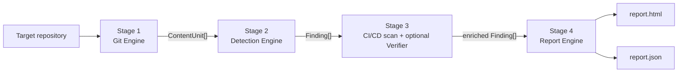

# Architecture

> Status: skeleton (Phase 1). Sections marked _TBD_ are filled in as each stage is implemented.

Git Leak Hunter scans the **entire reachable history** of a Git repository, not just the working
tree, because a secret deleted in a later commit stays recoverable until history is rewritten.

Pipeline: `DETECT → ANALYZE → VERIFY → REPORT`. Data model:
`Repository → ContentUnit → Finding → Report` (see `src/types.ts`, `schema/report.schema.json`).

## Data model

| Type          | Meaning                                                                                                                                                                                    |
| ------------- | ------------------------------------------------------------------------------------------------------------------------------------------------------------------------------------------ |
| `ContentUnit` | One file version as seen in one commit: `repo, commitHash, author, date, filePath, blobHash, content, origin, lineOffsets`.                                                                |
| `Finding`     | One detected secret at one location. Location-based `fingerprint`, redacted preview, severity, presence (`in-HEAD` / `history-only`), verification status. **No raw-secret field.**        |
| `Report`      | Repository, scan options, measured stats, severity summary and sorted findings. Serialised as `report.json` (validated against the schema) and rendered as a self-contained `report.html`. |

Design decision: the fingerprint hashes `(ruleId, blobHash, filePath, line, column)`. The spec lists
`(ruleId, blobHash, line, offset)`; `filePath` is added because the same blob can live at several
paths (see the `blob-reuse` fixture), and each path is a separate place that needs cleaning up. It
is still never derived from the secret value.

## Stage 1 — Git Engine (`src/git/`)

- Opens a local path, or clones a URL as a bare clone into a temp dir (hooks disabled, no
  checkout, removed afterwards even on failure).
- Walks `git log --all` with raw diff output (`-z`, full blob hashes, merges diffed against each
  parent) so it gets commit metadata plus the changed paths and their blob hashes.
- Reads content by blob hash through one long-lived `git cat-file --batch` process; it never checks
  out a commit.
- Counters (measured, never estimated): `commitsWalked`, `fileVersionsSeen`, `uniqueBlobsScanned`,
  `cacheHits`, `bytesScanned`, `durationMs`.

_TBD (Phase 2): exact git invocations, streaming parser, presence computation._

### Memoization (DAA connection)

A naive scan reads every file of every commit: `O(commits × files)`. Git Leak Hunter scans only the
files a commit changed, and keys detection results by blob hash (plus a ruleset/config hash), so
identical content reached through other commits, paths, branches or reverts is scanned once:
`O(unique blobs)`. Per-commit attribution (first commit, other-commit count, presence) is applied
on top of the cached per-blob result. `--no-cache` disables the cache so the benchmark can measure
the difference.

Invariant (Phase 3 test): the set of scanned blob hashes equals the set of reachable blobs from
`git rev-list --objects --all`, minus the deliberately skipped ones (binary, oversize, ignored).

## Stage 2 — Detection Engine (`src/detect/`)

1. **Signatures** — AWS, GitHub, Stripe, Slack, private keys; generic key-name matches go to entropy.
2. **Shannon entropy** — `H(X) = −Σ p(xᵢ)·log₂ p(xᵢ)`, with charset-specific thresholds.
3. **Suppression** — UUIDs, git SHAs, lockfile hashes, placeholders, known doc keys, repeated
   characters, data URIs, `.leakhunterignore`, inline `leakhunter:ignore`. Each reason is counted.
4. **Severity** — a pure, table-driven function (see `docs/RULES.md`).

_TBD (Phase 2)._

## Stage 3a — CI/CD scanning (`src/ci/`)

GitHub Actions `env:`/`with:` literals, GitLab CI `variables:`, Dockerfile `ENV`/`ARG`, and committed
credential files. They are scanned across history through the same ContentUnit/blob-cache path.
Malformed YAML falls back to text scanning. _TBD (Phase 2)._

## Stage 3b — Optional verification (`src/verify/`)

Opt-in only (`--verify --confirm-authorized`), read-only, with a hard host allowlist
(`sts.amazonaws.com`, `api.github.com`). Raw values live only in an in-memory vault that is dropped
after verification. _TBD (Phase 3)._

## Stage 4 — Report Engine (`src/report/`)

Redaction, severity-then-recency sort, schema-valid JSON, and a single-file HTML report (inline
CSS/JS, restrictive CSP, every dynamic value escaped, no external resources). _TBD (Phase 2)._

## Test fixtures

`test/fixtures/buildRepos.ts` builds eight repositories at test time with real `git` commands and
writes `ground-truth.json` (planted secrets and baits with file, commit, line and expected presence).
Every secret is generated at runtime from a seeded PRNG with vendor prefixes assembled from
fragments, so no token-shaped literal exists in this repository (enforced by
`test/unit/hygiene.test.ts`).

| Fixture           | Scenario                                                                                        |
| ----------------- | ----------------------------------------------------------------------------------------------- |
| `history-only`    | (a) AWS pair + GitHub token added, then removed                                                 |
| `head-secrets`    | (b) Stripe, Slack, private key, generic high-entropy still at HEAD                              |
| `blob-reuse`      | (c) one secret blob at 4 paths, deleted/re-added, on a side branch; toggling blobs              |
| `merge-conflict`  | (d) secret only in a conflict resolution, plus a file added only in the merge commit            |
| `ci-configs`      | (e) GitHub Actions, GitLab CI, Dockerfile, `.env`, `id_rsa`, `.npmrc`, `credentials.json`       |
| `false-positives` | (f) UUIDs, lockfile hashes, placeholders, `${{ secrets.X }}`, `.env.example`, repeated chars, … |
| `hostile`         | (g) XSS in file names/author/commit messages, newline/tab/leading-dash paths, huge file, binary |
| `clean`           | (h) no secrets; must yield zero findings                                                        |
